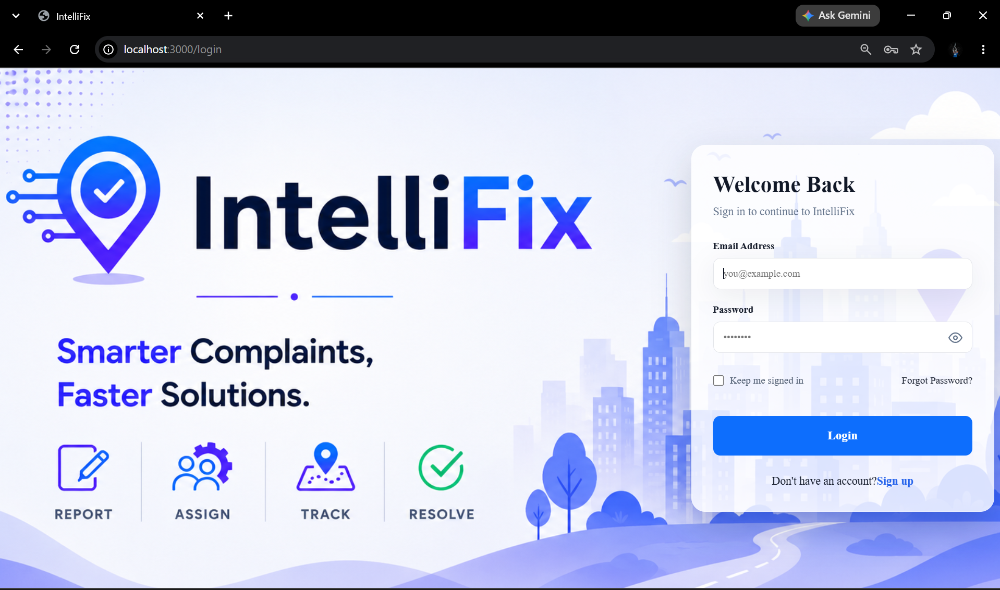
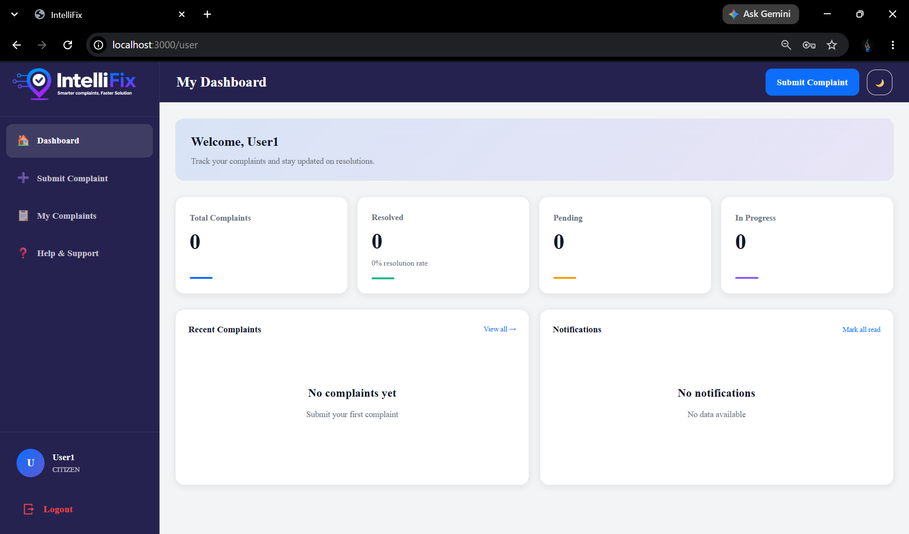
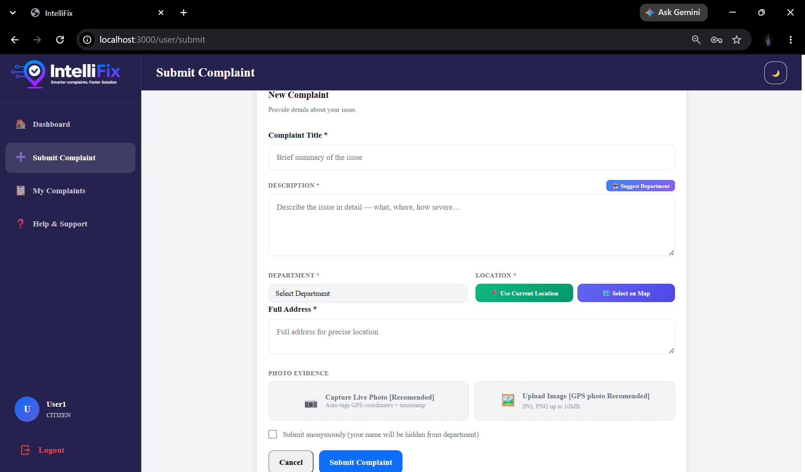
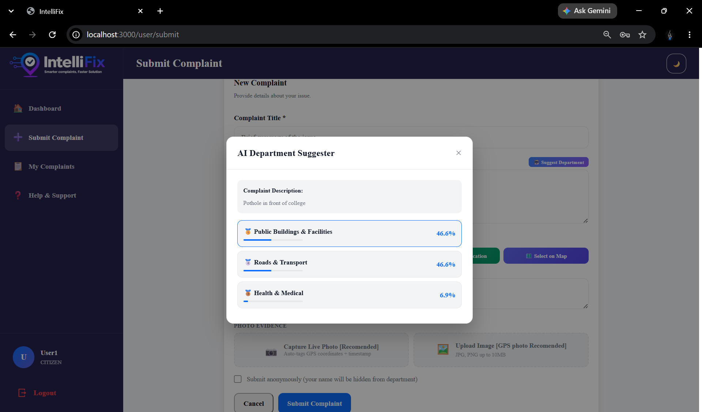
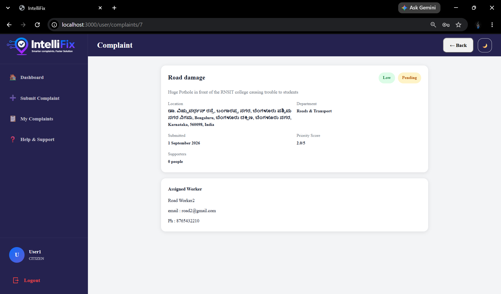
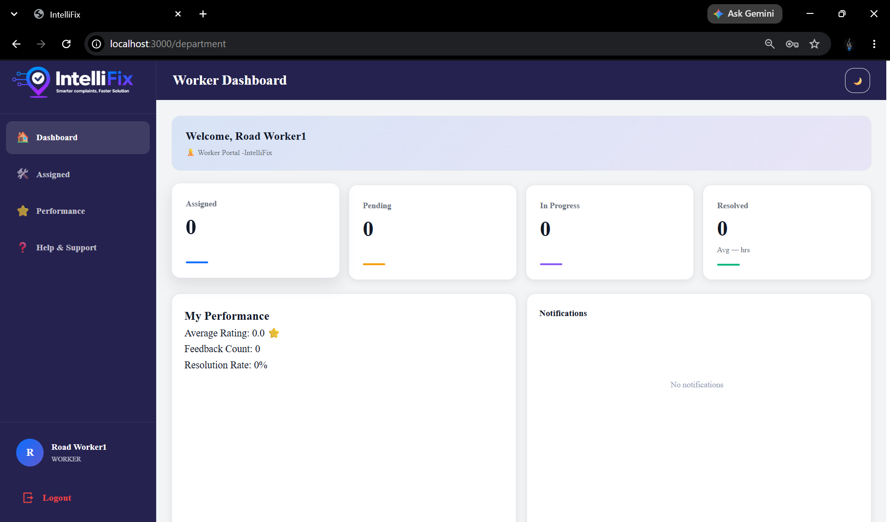
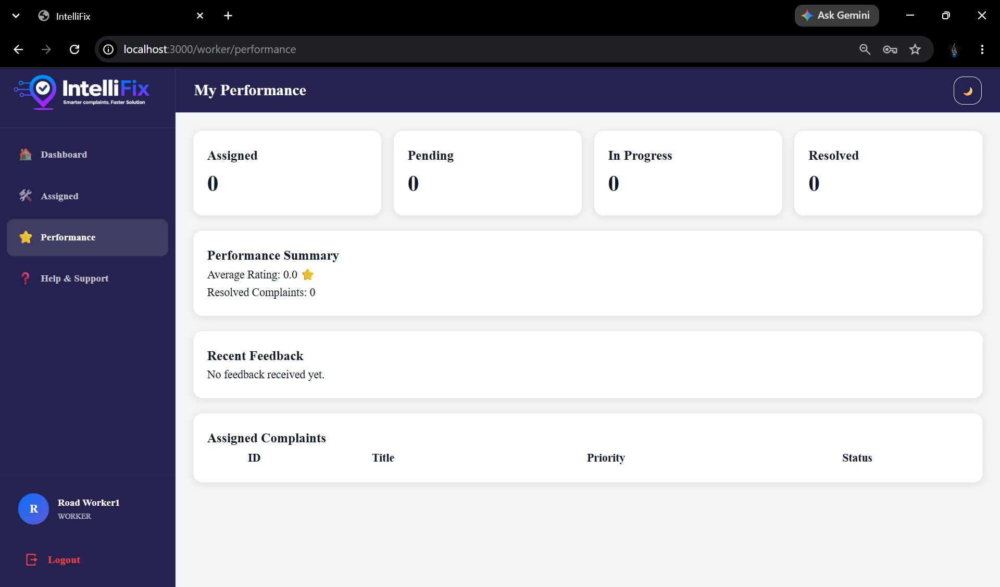
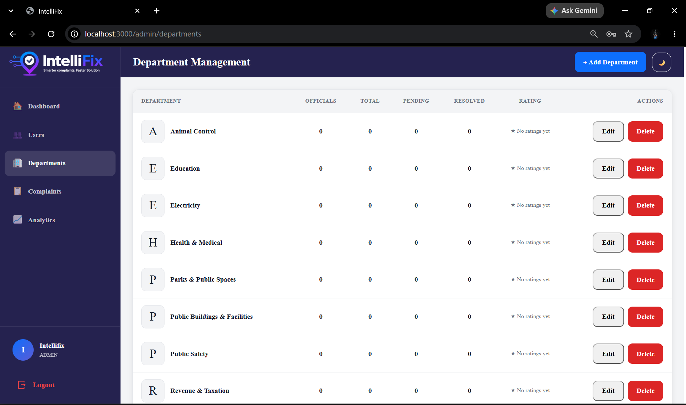
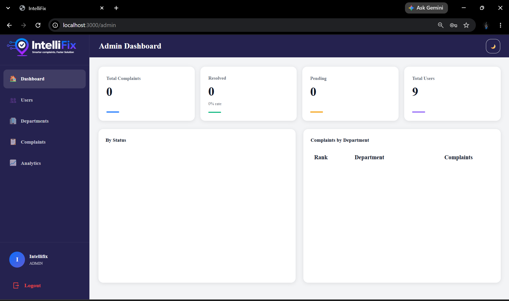

<h1 align="center">
  IntelliFix : An AI-Driven Smart Public Issue Resolving System 
</h1>
<p align="center">
  
</p>

<p align="center">
  <strong>An AI-powered civic complaint management platform for intelligent issue classification, priority prediction, complaint tracking, community support, and role-based resolution.</strong>
</p>

<p align="center">
  
  
  
  
  
  
  
  
  
  
</p>

---

## Project

**GitHub Repository:** https://github.com/Kirankumar-K18/Intellifix

**Current Release:** `v1.0.1`

---

## Overview

IntelliFix is an intelligent civic complaint management and resolution system designed to streamline the process of reporting, classifying, prioritizing, assigning, tracking, and resolving public complaints.

The platform allows citizens to submit civic issues such as potholes, waste management problems, water and drainage issues, electrical problems, and other public infrastructure concerns.

IntelliFix integrates Artificial Intelligence and Machine Learning to assist with department classification and complaint priority prediction. It also provides community-based complaint support, location-based existing complaint detection, real-time complaint updates, notifications, analytics, and role-based dashboards.

The system provides dedicated functionality for Citizens, Department Administrators, Workers, and System Administrators.

---

## Key Features

### Authentication & Security

* JWT-based authentication
* Access and refresh token workflow
* Automatic JWT token refresh
* Role-Based Access Control (RBAC)
* Custom Django User Model
* Secure login and logout
* Password change functionality
* Protected API endpoints
* Role-based complaint access

### Complaint Management

* Civic complaint submission
* Complaint title and description
* Complaint image upload
* Complaint location and address
* Latitude and longitude storage
* Complaint severity selection
* Population affected tracking
* Complaint status management
* Complaint assignment to workers
* Complaint resolution tracking
* Complaint history and timeline

### AI-Powered Classification

* AI-based department suggestion
* Text-based complaint classification
* Top department predictions
* Confidence-based suggestions
* TF-IDF feature extraction
* Logistic Regression classification model

### Intelligent Priority Prediction

* Machine Learning-based priority prediction
* Random Forest classification
* Severity-based analysis
* Population impact analysis
* Complaint frequency analysis
* Image verification factor
* Priority score calculation
* Low, Medium, High, and Critical priority levels

### Existing Complaint Detection

* Detects potentially duplicate complaints
* Location-based matching
* 30-meter physical location radius
* Department-based filtering
* Complaint title and description similarity
* Active complaint filtering
* Existing complaint support option

### Community Complaint Support

* Citizens can support existing complaints
* Prevents duplicate support from the same user
* Complaint owners cannot support their own complaint
* Support count tracking
* Automatic priority recalculation
* Support removal functionality
* Worker and department administrator notifications

### Live Camera & Location Capture

* Device camera integration
* Live complaint image capture
* Timestamp watermark on captured images
* GPS location capture
* High-accuracy geolocation
* Latitude and longitude storage
* Photo timestamp tracking
* Complaint image verification workflow

### Notifications

* In-app notifications
* Complaint assignment notifications
* Complaint support notifications
* Feedback notifications
* Status-related notifications
* Unread notification count
* Mark notification as read
* Mark all notifications as read
* Email notification support

### Analytics

* Role-scoped analytics
* Complaint statistics
* Department analytics
* Priority analysis
* Complaint status statistics
* Worker performance information
* Recent activity monitoring
* Complaint map visualization
* Worker performance reports

### Feedback & Resolution

* Feedback submission for complaints
* 1–5 rating system
* Feedback comments
* Resolved complaint feedback
* Worker feedback notifications
* Complaint resolution tracking

---

## User Roles

| Role | Responsibilities |
| --- | --- |
| Admin | Manage users, departments, complaints, analytics, and overall system operations |
| Department Admin | Manage department complaints, assignments, statuses, analytics, and escalation |
| Worker | View and update complaints assigned to them and manage resolution |
| Citizen | Submit complaints, track complaints, support existing complaints, and provide feedback |

---

## Technology Stack

| Category | Technology |
| --- | --- |
| Frontend | React 18 |
| Build Tool | Vite |
| Routing | React Router v6 |
| Charts | Recharts |
| Backend | Django 4.2 |
| API Framework | Django REST Framework |
| Language | Python 3.11 |
| Database | MySQL 8.0 |
| Authentication | JWT |
| Machine Learning | Scikit-learn |
| Department Model | TF-IDF + Logistic Regression |
| Priority Model | Random Forest |
| API Client | Axios |
| Notifications | Django Notifications + Email |
| Containerization | Docker |
| Web Server | Nginx |
| Version Control | Git & GitHub |

---

## Application Screenshots

### Login Page



### User Dashboard



### Submit Complaint Page



### AI Department Suggester [Chatbot]



### Department Dashboard


### Complaint Detail Page



### Worker Dashboard



### Worker Performance



### Departments Management



### Admin Dashboard


---

## Project Structure

```text
Intellifix/
│
├── ai/
│   ├── dataset/
│   │   ├── train/
│   │   ├── validation/
│   │   └── test/
│   │
│   ├── models/
│   │   ├── complaint_verifier.keras
│   │   ├── complaint_verifier_final.keras
│   │   ├── labels.json
│   │   └── training_history.pkl
│   │
│   ├── notebooks/
│   │   ├── data_preprocessing.ipynb
│   │   ├── evaluate_model.ipynb
│   │   └── train_model.ipynb
│   │
│   ├── utils/
│   ├── train.py
│   ├── test_model.py
│   ├── check_dataset.py
│   └── README.md
│
├── backend/
│   ├── manage.py
│   ├── requirements.txt
│   ├── Dockerfile
│   │
│   ├── intellifix_project/
│   │   ├── settings.py
│   │   ├── urls.py
│   │   ├── wsgi.py
│   │   └── asgi.py
│   │
│   ├── apps/
│   │   ├── users/
│   │   │   └── # User authentication and management
│   │   │
│   │   ├── complaints/
│   │   │   └── # Complaint management, support and feedback
│   │   │
│   │   ├── departments/
│   │   │   └── # Department management
│   │   │
│   │   ├── analytics/
│   │   │   └── # Analytics and reporting
│   │   │
│   │   ├── notifications/
│   │   │   └── # In-app and email notifications
│   │   │
│   │   └── chatbot/
│   │       └── # AI/ML prediction APIs
│   │
│   ├── ml/
│   │   ├── train.py
│   │   ├── predictor.py
│   │   └── saved_models/
│   │
│   └── media/
│       └── # Uploaded complaint images
│
├── frontend/
│   ├── src/
│   │   ├── components/
│   │   ├── context/
│   │   ├── pages/
│   │   │   ├── user/
│   │   │   ├── department/
│   │   │   ├── admin/
│   │   │   └── worker/
│   │   │
│   │   ├── services/
│   │   │   └── api.js
│   │   │
│   │   ├── App.jsx
│   │   ├── main.jsx
│   │   └── index.css
│   │
│   ├── package.json
│   ├── Dockerfile
│   ├── nginx.conf
│   └── vite.config.js
│
├── docs/
│   └── screenshots/
│       ├── logo.png
│       ├── login.png
│       ├── user_dashboard.png
│       ├── submit_complaint.png
│       ├── department_suggester.png
│       ├── department_dashboard.png
│       ├── complaint_detail.png
│       ├── worker_dashboard.png
│       ├── worker_performance.png
│       ├── departments.png
│       └── admin_dashboard.png
│
├── docker-compose.yml
├── .gitignore
└── README.md
```

---

## Key Highlights

- AI-assisted civic complaint classification
- Machine Learning-based complaint priority prediction
- Location-aware duplicate complaint detection
- Community-driven complaint support
- Live camera capture with timestamp
- GPS-based complaint location tracking
- Role-based dashboards
- Worker assignment and complaint resolution workflow
- Department-specific complaint management
- Complaint escalation mechanism
- In-app and email notifications
- Complaint analytics and map visualization
- JWT authentication with automatic token refresh
- MySQL database integration
- Docker-based application setup

---

## Artificial Intelligence & Machine Learning

### Department Classification

IntelliFix uses a text classification pipeline to suggest the most appropriate department for a submitted complaint.

**Algorithm:**

```text
Complaint Description
        ↓
TF-IDF Vectorizer
        ↓
Logistic Regression
        ↓
Department Prediction
        ↓
Top Department Suggestions
```

The model analyses the complaint description and generates department suggestions with confidence scores.

**Endpoint:**

```text
POST /api/chatbot/suggest/
```

**Example Input:**

```json
{
  "description": "There is a large pothole on the main road."
}
```

### Priority Prediction

IntelliFix uses a Random Forest model to assist in determining complaint priority.

The prediction considers factors such as:

- Severity
- Population affected
- Complaint frequency
- Image availability
- Complaint characteristics

**Endpoint:**

```text
POST /api/chatbot/predict-priority/
```

The system classifies complaints into:

- Low
- Medium
- High
- Critical

In addition to ML prediction, complaint priority can be recalculated when community support changes.

---
## Image Verification Model Results
### Dataset and Model Configuration

| Parameter | Details |
|---|---|
| **Dataset** | IntelliFix Image Dataset |
| **Task** | Binary Image Classification |
| **Classes** | Relevant, Irrelevant |
| **Total Images** | 33,311 |
| **Training Images** | 27,729 |
| **Validation Images** | 1,612 |
| **Testing Images** | 3,970 |
| **Train–Validation–Test Split** | 80% – 5% – 15% |
| **Model** | MobileNetV2 |
| **Input Image Size** | 224 × 224 × 3 |
| **Transfer Learning** | Yes |
| **Pretrained Weights** | ImageNet |

### Model Performance

| Metric | Result |
|---|---:|
| **Test Accuracy** | **98.41%** |
| **Test Loss** | **0.0498** |
### Evaluation Command

```bash
cd ai
python test_model.py
```
---
## Existing Complaint Detection

Before creating a new complaint, IntelliFix checks whether a similar active complaint already exists.

The system compares:

- Department
- Geographic location
- Complaint title
- Complaint description

Complaints within a **30-meter radius** are considered candidates for the same physical location.

Text similarity is then used to determine whether the complaints describe a similar issue.

```text
New Complaint
      │
      ▼
Department Check
      │
      ▼
Location Check
      │
      ▼
30-Meter Radius
      │
      ▼
Text Similarity
      │
      ▼
Existing Complaint?
     / \
   Yes  No
    │    │
    ▼    ▼
 Support Create New
 Existing Complaint
```

**Endpoint:**

```text
POST /api/complaints/check-existing/
```

---

## Community Support

Citizens can support an existing complaint instead of submitting another complaint for the same issue.

The support workflow is:

```text
Existing Complaint
        ↓
Citizen Supports
        ↓
Support Count Increases
        ↓
Priority Recalculated
        ↓
Worker / Department Notification
```

Each citizen can support a complaint only once.

**Support Endpoint:**

```text
POST /api/complaints/{id}/support/
```

**Remove Support:**

```text
DELETE /api/complaints/{id}/support/remove/
```

---

## Live Camera Capture

The complaint submission module supports live camera capture using browser camera APIs.

The workflow includes:

- Device camera access
- Live video preview
- Image capture
- Timestamp watermark
- GPS coordinate retrieval
- Image upload
- Complaint location storage

The system stores:

```text
latitude
longitude
photo_timestamp
photo_captured
```

This provides additional evidence and location context for submitted complaints.

---

## Database Design

The system uses **MySQL** as its primary relational database.

### Core Entities

```text
users
    │
    ├── complaints
    │       │
    │       ├── complaint_updates
    │       ├── feedback
    │       ├── complaint_support
    │       └── notifications
    │
    └── departments
```

### Main Tables

```text
users
departments
complaints
complaint_updates
complaint_support
feedback
notifications
```

### Complaint Data

```text
complaints
├── id
├── title
├── description
├── location
├── address
├── latitude
├── longitude
├── image
├── severity
├── population_affected
├── population_score
├── frequency_score
├── priority
├── priority_score
├── ai_department_suggestion
├── status
├── user_id
├── department_id
├── assigned_to_id
├── photo_timestamp
├── photo_captured
├── is_image_verified
├── manual_review
├── is_escalated
├── resolved_at
├── created_at
└── updated_at
```

---

## Security

IntelliFix implements multiple security mechanisms to protect users and system resources.

- JWT authentication
- Access and refresh tokens
- Automatic token refresh
- Role-Based Access Control
- Protected REST API endpoints
- Object-level complaint permissions
- Department-level access restrictions
- Worker assignment restrictions
- Django ORM protection against SQL injection
- Secure password hashing
- Authentication-protected complaint operations

---

## Local Installation

### Prerequisites

- Python 3.11+
- Node.js 20+
- MySQL 8.0
- Git
- Docker (optional)

### Clone Repository

```bash
git clone https://github.com/Kirankumar-K18/Intellifix.git

cd Intellifix
```

### Backend Setup

```bash
cd backend
```

Create a virtual environment.

#### Windows

```bash
python -m venv venv

venv\Scripts\activate
```

#### Linux / macOS

```bash
python3 -m venv venv

source venv/bin/activate
```

Install dependencies:

```bash
pip install -r requirements.txt
```

Configure the MySQL database and required environment variables.

Run migrations:

```bash
python manage.py migrate
```

Train the ML models:

```bash
python ml/train.py
```

Start the backend:

```bash
python manage.py runserver
```

Backend API:

```text
http://127.0.0.1:8000/api/
```

Django Admin:

```text
http://127.0.0.1:8000/admin/
```

### Frontend Setup

Open a new terminal:

```bash
cd frontend

npm install

npm run dev
```

The frontend will be available at:

```text
http://localhost:3000
```

---

## Docker Deployment

IntelliFix includes Docker configuration for running the application using containerized services.

```bash
docker compose up --build
```

The Docker environment is designed to run:

```text
MySQL
  ↓
Django Backend
  ↓
React Frontend
  ↓
Nginx
```

---

## Environment Variables

Create the required environment configuration according to your local or production setup.

```env
SECRET_KEY=your-secret-key

DEBUG=True

DB_NAME=intellifix_db
DB_USER=intellifix_user
DB_PASSWORD=your-database-password
DB_HOST=localhost
DB_PORT=3306

EMAIL_HOST=smtp.gmail.com
EMAIL_HOST_USER=your-email
EMAIL_HOST_PASSWORD=your-app-password

VITE_API_URL=http://localhost:8000/api
```

> **Security:** Do not commit credentials, API keys, passwords, or secret environment files to GitHub.

---

## Complaint Resolution Workflow

```text
Citizen
   │
   ▼
Submit Complaint
   │
   ├── Image
   ├── Description
   ├── Location
   └── Severity
   │
   ▼
AI Department Suggestion
   │
   ▼
Existing Complaint Check
   │
   ├── Existing → Support Complaint
   │
   └── New → Create Complaint
              │
              ▼
       Priority Prediction
              │
              ▼
       Department Assignment
              │
              ▼
        Worker Assignment
              │
              ▼
         In Progress
              │
              ▼
           Resolved
              │
              ▼
           Feedback
```

---

## Priority Management

Complaint priority is influenced by multiple factors including:

- Severity
- Population affected
- Complaint frequency
- Image verification
- Community support

The system calculates a priority score and categorizes complaints as:

| Priority | Score Range |
|----------|-------------|
| Critical | 4.5 – 5.0 |
| High | 3.5 – 4.49 |
| Medium | 2.5 – 3.49 |
| Low | Below 2.5 |

Community support can increase the priority score of an existing complaint, helping frequently reported public issues receive greater attention.

---

## Future Enhancements

- Advanced AI-based complaint similarity detection
- Improved duplicate complaint clustering
- Computer Vision-based image verification
- Real-time WebSocket notifications
- Mobile application
- Advanced GIS-based complaint visualization
- Predictive maintenance analytics
- Automated complaint routing
- Multi-language complaint support
- Advanced citizen engagement analytics
- Cloud production deployment
- Automated report generation

---

## Project Status

**Current Status:** Working Prototype / v1.0.1

The current version includes the core complaint submission, AI/ML assistance, complaint management, existing complaint detection, community support, role-based access, notifications, analytics, and resolution workflow.

---

## Author

**Kirankumar K**

Computer Science and Data Science Engineering

RNS Institute of Technology

**GitHub:** https://github.com/Kirankumar-K18

**Repository:** https://github.com/Kirankumar-K18/Intellifix

---

## License

This project is developed for educational and academic purposes.
